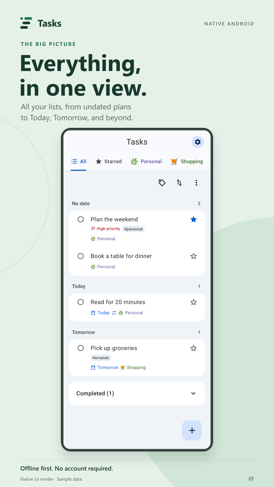
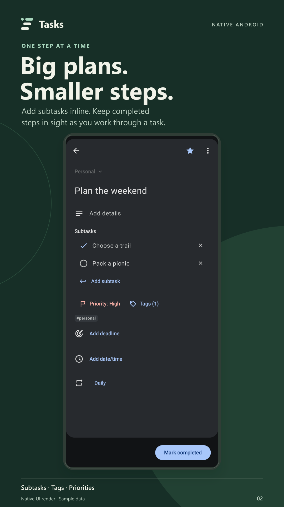
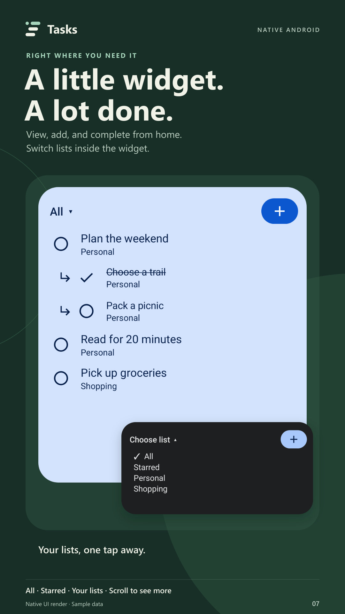

# Tasks

A private task manager for Android, built with Kotlin and Jetpack Compose. Organize tasks offline and synchronize with a CalDAV server of your choice.

[Source repository](https://github.com/Shaaaafin/Tasks) · [Report an issue](https://github.com/Shaaaafin/Tasks/issues)

**Apache 2.0 · Android 9 or later · Optional CalDAV · No ads or analytics**

## Features

- **All:** an overview of every list, with undated tasks first, followed by overdue tasks, Today, Tomorrow, and later dates.
- **Flexible organization:** lists, subtasks, notes, stars, tags, and task priorities. Add and edit subtasks inline in quick-add or the task editor, with a return-arrow Add action below the list. Checked subtasks stay crossed out in place until the parent is complete.
- **My order:** hold to lift a task together with its subtasks, with a press wave across the whole family, then drag it into your preferred order, or sort by date, priority, star, or title. Each tab remembers its sort setting.
- **Recurring tasks:** daily, weekly, monthly, yearly, and custom schedules, with a start date, time, interval, weekdays, and an end date or occurrence limit. Repeating tasks can contain subtasks; each new occurrence starts with unchecked copies.
- **Reminders and deadlines:** separate scheduled reminders and deadlines, with Android notification support.
- **Controlled synchronization:** sync while using the app, only while charging, or manually. An optional Wi-Fi restriction is available.
- **Task actions:** choose whether long-press reorders tasks or opens a menu at the press position. Tap a task to edit it, add subtasks, or access archive/delete actions. Restore archived tasks from Settings.
- **Appearance:** light, shaded dark with a darker canvas and lighter cards/tabs, AMOLED pure black, and system themes; optional wallpaper colors; customizable tab colors, icons, and emoji; optional All and Starred tabs. Leading tabs stay left-aligned; later selections center in sync with the page swipe.
- **Home-screen widget:** scroll the full list, distinguish subtasks by branch arrows and indentation, switch between All, Starred, and individual lists inside the widget, complete tasks, open task details, and add tasks without periodic polling.

The app does not require a Google account or Google Play Services. Tasks are stored locally. CalDAV credentials are protected with Android Keystore.

## Screenshots

<p>
  
  
  
</p>

The [full eight-card gallery](docs/store-assets/overview.png) uses native app renders with sample data and feature captions. These are not physical-device captures. [Screenshot files and provenance](docs/store-assets/README.md) are included with the editable compositions.

## Installation

An independent [F-Droid-compatible repository](https://Shaaaafin.github.io/Tasks/) is available through GitHub Pages. Add it with the repository address and pinned fingerprint described in [REPOSITORY.md](docs/REPOSITORY.md). It uses the same developer-signed APK as GitHub Releases.

Download an APK from this repository's Releases page when a release is available. Install updates over the existing application to retain its data. There is currently no published F-Droid listing.

Android 9 (API 28) or later is required. The current build targets Android 17 (API 37). Physical Android 17 and CalyxOS compatibility testing is still in progress.

## Getting started

1. Open the app and add a task. No account is required for local use.
2. To enable synchronization, open **Settings → Add CalDAV account** and enter your server's HTTPS address, username, and app password.
3. Choose a synchronization mode and select **Sync now** for the initial synchronization. The server must support VTODO task collections.
4. Select **Sort → My order**, then hold a task and drag it up or down. Subtasks can be reordered within their parent. Choose **Date order** to return to the chronological summary.
5. Select **Add subtask** below the inline **Subtasks** list in quick-add or a task editor. Type directly in each row; the keyboard Next action adds another row. Checking the parent completes the family, and checking every subtask also completes the parent.
6. Choose **Settings → Long press** to switch between reordering and the task menu. Long-press a tab to change its appearance. Add tags and priority when creating or editing a task.

To add the widget, open the launcher's widget picker, select Tasks, and choose a list. Tap the widget's list title to switch lists within the widget. Resize it freely and scroll to reach every active task.

The default synchronization mode runs only while the app is visible. Date-only reminders are scheduled for 09:00 local time. Exact alarm permission is optional; Android may defer delivery when it is not granted.

Task tags, priorities, recurrence, archive state, and custom order synchronize through CalDAV. Archive state uses an app-specific property; other clients may display those tasks as active. Tab appearance and sort preferences are local to each device. Clear a tag filter before dragging tasks.

## Building from source

Required tools:

| Tool | Version |
| --- | --- |
| JDK | 21 |
| Android SDK platform | 37 / Android 17 |
| Android SDK Build Tools | 36.0.0 |
| Gradle | 9.5.0, supplied by the wrapper |
| Android Gradle Plugin | 9.3.0 |

Configure the Android SDK in Android Studio, through `ANDROID_HOME`, or in an untracked `local.properties` file.

On Linux or macOS:

```sh
chmod +x gradlew
./gradlew :app:assembleDebug :app:testDebugUnitTest :app:lintDebug --no-configuration-cache
```

On Windows:

```powershell
.\gradlew.bat :app:assembleDebug :app:testDebugUnitTest :app:lintDebug --no-configuration-cache
```

The debug APK is written to `app/build/outputs/apk/debug/`. A release build without local signing configuration produces an unsigned APK. See [release instructions](docs/RELEASING.md) for signing and publication.

## Repository layout

```text
app/                 Application source, resources, and tests
.github/             Continuous integration and issue templates
fastlane/            Store descriptions, changelogs, and screenshot directories
packaging/fdroid/    F-Droid build recipe template
build-support/       Examples of local configuration
app/build.gradle.kts Application build configuration
gradle/              Gradle wrapper
scripts/             Repository export utilities
tools/               Optional local development utilities
docs/                Architecture, privacy, releases, and validation
```

Local SDKs, signing keys, build output, and downloaded research images are excluded from version control and repository exports.

## Development status

The corrected 0.2.0 build passed 83 automated tests covering persistence, schema migration, CalDAV exchanges, recurrence, reminders, widgets, and native UI interaction. Android lint and the signed release build also passed. Details are recorded in [validation notes](docs/VALIDATION.md).

Real-server interoperability, physical-device notification timing, launcher behavior, and measured battery consumption require further validation. Incremental synchronization currently compares collection ETags rather than using sync tokens. See [architecture and limitations](docs/ARCHITECTURE.md).

## Contributing

Please read [CONTRIBUTING.md](CONTRIBUTING.md). Report reproducible defects through the issue templates and use [SECURITY.md](SECURITY.md) for security reports.

[Privacy policy](docs/PRIVACY.md) · [Changelog](CHANGELOG.md) · [GitHub upload](docs/GITHUB.md) · [F-Droid publication steps](docs/FDROID.md)

## License

Copyright 2026 the project contributors.

Licensed under the [Apache License, Version 2.0](LICENSE). Third-party components and attribution are described in [NOTICE.md](NOTICE.md).
